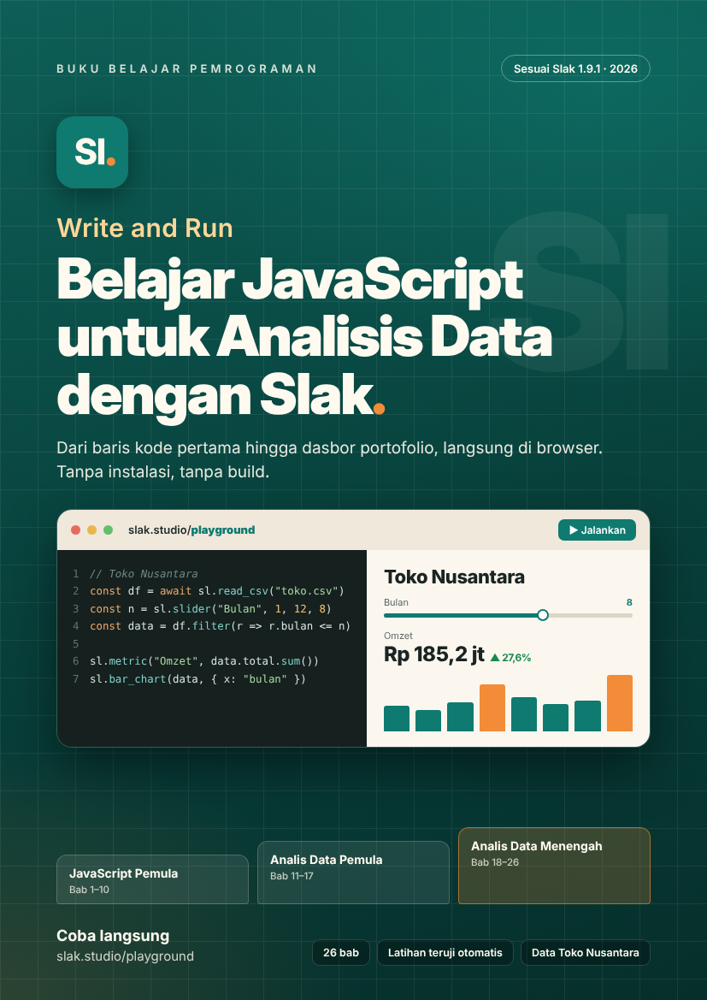

  

# Write and Run

**Belajar JavaScript untuk Analisis Data dengan Slak**

Buku belajar pemrograman JavaScript dari nol hingga menjadi analis data tingkat menengah. Setiap contoh kode berjalan langsung di browser memakai [Slak](https://slak.studio) 1.9.1, tanpa instalasi, tanpa server, dan tanpa build.

Situs buku ini dibuat seluruhnya dengan Slak: setiap blok kode di dalam bab benar-benar dijalankan, sehingga hasil, tabel, grafik, peta, dan uji otomatis yang kamu lihat adalah keluaran Slak yang sesungguhnya.

## Membaca buku

- **Edisi web:** buka `index.html`. Bisa dengan klik dua kali dari komputer, dari Slak Studio, atau lewat hosting seperti GitHub Pages.
- **Edisi PDF:** `Write-and-Run.pdf`, dibuat dari naskah yang sama dengan edisi web.
- **Coba langsung:** setiap contoh punya tautan **Buka di Playground** ke [slak.studio/playground](https://slak.studio/playground/).

## Isi buku

Buku terdiri dari 26 bab dalam tiga tahap, ditambah tujuh lampiran dan glosarium.

**Mulai**
- Sebelum Mulai

**Tahap 1 · JavaScript Pemula**
1. Mengenal JavaScript lewat Slak
2. Nilai, Variabel, dan Tipe Data
3. Operator dan Percabangan
4. Perulangan
5. Fungsi
6. Larik (Array)
7. Objek dan Larik Objek
8. Teks, Angka, dan Tanggal
9. Galat dan Debugging
10. Cara Slak Menjalankan Skrip

**Tahap 2 · Analis Data Pemula**

11. Dari Data Mentah ke Struktur
12. Asinkron dan Mengambil Data
13. Membersihkan Data dengan JavaScript Murni
14. Dari JavaScript Murni ke Slak Data
15. Meringkas Data
16. Visualisasi Dasar
17. Proyek: Laporan Interaktif Pertama

**Tahap 3 · Analis Data Menengah**

18. Menggabungkan dan Membentuk Ulang Data
19. Statistik Deskriptif Lanjutan
20. Data Deret Waktu
21. SQL di Browser
22. Tren, Prediksi, dan Machine Learning Dasar
23. Peta dan Data Wilayah
24. Merapikan dan Menguji Kode
25. Proyek Akhir: Dasbor Portofolio Multi-Halaman
26. Langkah Berikutnya

**Lampiran**
- A · Ringkasan API Slak di Buku Ini
- B · Cheat Sheet JavaScript untuk Data
- C · Cheat Sheet SQL
- D · Kunci Jawaban Latihan
- E · Dataset Toko Nusantara
- F · Daftar Pesan Galat Umum
- G · Memakai Contoh Streamlit dari Internet
- Glosarium

## Isi folder

| Berkas / folder | Isi |
|---|---|
| `index.html` | Edisi web buku |
| `beranda.js` | Halaman beranda edisi web (sampul, contoh yang berjalan, tahap belajar) |
| `Write-and-Run.pdf` | Edisi PDF |
| `naskah/` | Sumber Markdown setiap bab dan lampiran |
| `proyek-akhir/` | Dasbor Toko Nusantara dari Bab 25, siap dibuka, beserta berkas ujinya |
| `slak*.js` | Slak 1.9.1, tidak diubah; `slak-docs.js` versi 0.2.0, sama dengan yang dipakai slak.studio |
| `*.csv` dan `*.csv.js` | Dataset Toko Nusantara; versi `.csv.js` membuat data terbaca saat halaman dibuka dengan klik dua kali |
| `toko-nusantara-besar.csv` | 250 ribu transaksi untuk latihan data besar (Bab 12 dan 21) |
| `toko-analisis.js`, `toko-analisis.mjs` | Contoh berkas JavaScript terpisah dan ES Module (Bab 24) |
| `sampul/` | Sampul dalam PNG, PDF, dan HTML |
| `bahan/buat_data.py` | Skrip pembuat dataset (hasilnya selalu sama) |
| `LICENSE`, `DAFTAR-LISENSI.md`, `Lisensi/` | Lisensi Slak dan komponen pihak ketiganya |

## Dataset Toko Nusantara

Toko Nusantara adalah jaringan toko oleh-oleh **fiktif** dengan sepuluh cabang dari Jayapura sampai Jakarta, berisi transaksi 2023–2024. Semua nama, angka, dan pelanggan di dalamnya rekaan. Rinciannya ada di Lampiran E.

## Catatan teknis

- Semua kode di buku ini sesuai dengan Slak 1.9.1 dan sudah diuji otomatis.
- Contoh DuckDB (Bab 21) dan Python (`sl.python`) membutuhkan internet untuk mengunduh mesinnya.
- Contoh ES Module (Bab 24) hanya berjalan lewat hosting, tidak saat halaman dibuka dengan klik dua kali.
- Tata letak cetak buku ditambahkan di `index.html` sebagai CSS biasa, tanpa mengubah Slak.

## Lisensi

Slak dan komponennya dirilis dengan lisensi MIT; lihat `LICENSE` dan `DAFTAR-LISENSI.md`. Lisensi itu berlaku untuk berkas Slak, bukan untuk naskah buku.
